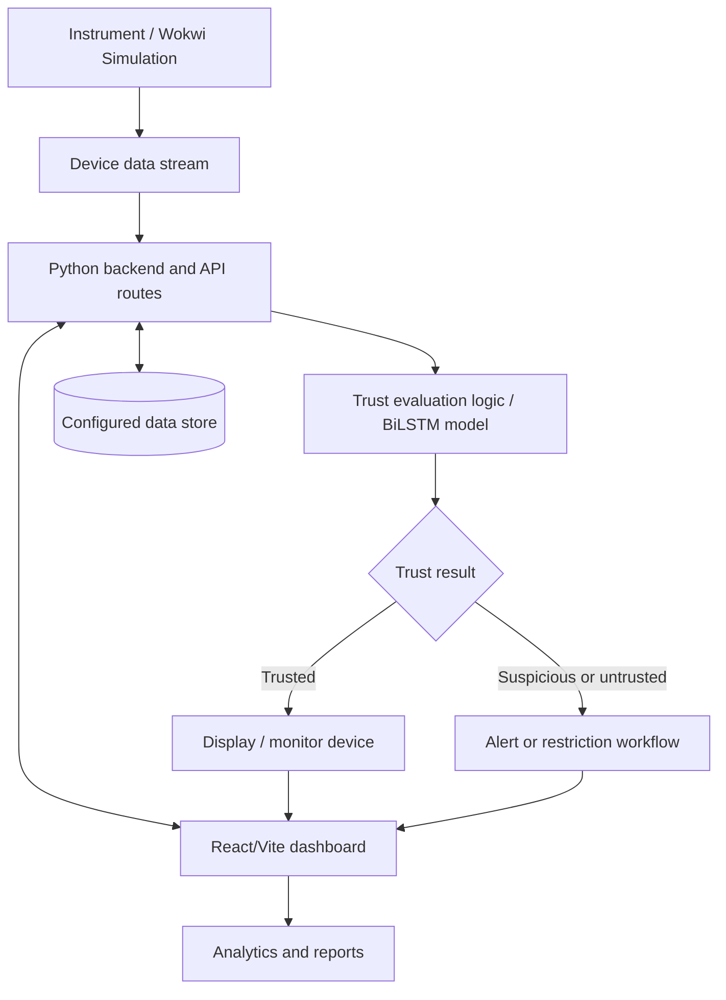

# TRUSTWEIGH — Technical Design Document

## 1. Purpose

TRUSTWEIGH is a prototype intended to detect and help prevent tampering in weighing and measuring instruments by monitoring device information, evaluating trust, and presenting device status and alerts.

This document describes the repository at a high level. Details marked **verify in code** must be confirmed against the implementation before this document is treated as an exact description.

## 2. Repository components

| Component | Location | Responsibility |
|---|---|---|
| Web interface | `frontend/` | Dashboard and user-facing views |
| Backend | `backend/` | API routes and application logic |
| Trust model | `backend/bilstm_trust_model.py` | BiLSTM-related trust model code (verify input/output schema in code) |
| Device/Wokwi integration | `backend/` and `wokwi/` | Device stream and simulation integration (verify exact data flow) |
| Simulation files | `wokwi/` | Wokwi diagram, sketch, and configuration |
| Reports/alerts | `backend/routes/` and frontend views | Alert, analytics, and report functionality |

## 3. High-level architecture

**Important:** This is a conceptual diagram inferred from the repository's filenames and project description. Verify the real database, model invocation, device stream, and restriction behavior in source code. Do not claim an automatic device lock/block unless that behavior is implemented and tested.

## 4. Typical data flow (to verify)

1. An instrument or simulator produces device information.
2. The backend receives and validates the incoming information.
3. Trust-related logic evaluates the device data.
4. The backend records or returns the result according to its configured data store and routes.
5. The frontend requests information from the backend and displays devices, alerts, analytics, or reports.

Confirm the actual sequence in `backend/main.py`, `backend/routes/`, `backend/database.py`, `backend/models.py`, and the stream runner files.

## 5. Frontend

The frontend uses React and Vite based on the repository's `frontend/package.json` and source layout. Views include device trust evaluation, alerts, analytics, reports, and settings.

Verify the actual API URL in `frontend/src/api.js` and keep it consistent with the backend's host and port.

## 6. Backend and API

The backend is implemented in Python. Route modules currently present include alerts, analytics, authentication, devices, reports, settings, trust, and Wokwi bridge.

**Verify in code:** framework, endpoint paths, request/response schemas, authentication requirements, database type, and error responses. Document each endpoint only after confirming it from the route source.

## 7. Trust evaluation

A BiLSTM-related file exists at `backend/bilstm_trust_model.py`. Confirm:
- How the model is loaded and invoked.
- The expected input features and preprocessing.
- The meaning and range of the output score.
- Thresholds that determine trusted/suspicious/untrusted states.
- What happens when model inference fails.

Do not interpret example scores in `sample_data/` as real model outputs.

## 8. Data storage

Inspect `backend/database.py` and `backend/models.py` to document:
- The database engine and connection setup.
- Tables/entities and their relationships.
- Required configuration variables.
- Data retention and error handling.

Never include live credentials in this document.

## 9. Security considerations

- Keep credentials in environment variables or a secret manager.
- Validate and authenticate device and API inputs where applicable.
- Use HTTPS and secure authentication in deployed environments.
- Avoid exposing internal errors or secrets in API responses and logs.
- Apply least-privilege database access.
- Test authorization for device changes, settings, and reports.
- Rotate any credential that has been exposed or committed.

## 10. Verification and testing

See `tests/TEST_CASES.md`. Record actual test results (pass/fail, date, environment, and notes) rather than marking tests as passed without running them.

## 11. Limitations and future improvements

Potential improvements, subject to project scope:
- Add automated unit and integration tests.
- Document API schemas and environment variables.
- Add reproducible dependency manifests.
- Add structured logging and monitoring.
- Validate model quality against labelled test data.
- Add CI checks for tests, formatting, and secret scanning.
